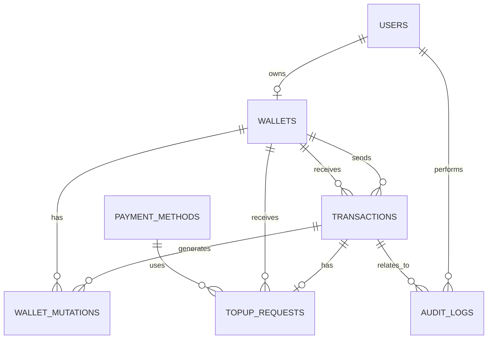

# Ewallet App MVC

## API Endpoints

Base URL: `/api`

### Users

| Endpoint Path                  | HTTP Method | Description                        | Available |
| ------------------------------ | ----------- | ---------------------------------- | --------- |
| `/api/users`                   | GET         | Get all users                      |           |
| `/api/users/{id}`              | GET         | Get user detail by ID              |           |
| `/api/users`                   | POST        | Create user and initialize wallet  |           |
| `/api/users/{id}`              | PUT         | Update user profile                |           |
| `/api/users/{id}`              | DELETE      | Delete user by ID                  |           |
| `/api/wallets/{userId}`        | GET         | Get wallet information by User ID  |           |
| `/api/wallets/{userId}/topups` | POST        | Top up wallet balance              |           |
| `/api/transfers`               | POST        | Transfer balance to another wallet |           |
| `/api/users/{id}/transactions` | GET         | Get user transaction history       |           |

## Getting Started

### Prerequisites

- .NET 10 SDK
- SQL Server
- Visual Studio Code or Visual Studio
- REST Client extension or Swagger UI (optional)

### Clone Repository

```bash
git clone https://github.com/bando9/koda-b1-weekly5
cd Ewallet.Mvc
```

### Database Configuration

Configure the SQL Server connection string in `appsettings.json` or user secrets.

```json
{
  "ConnectionStrings": {
    "Ewalletdb": "Server=YOUR_SERVER;Database=EwalletDb;Trusted_Connection=True;TrustServerCertificate=True;"
  }
}
```


